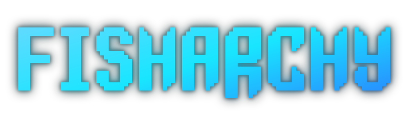
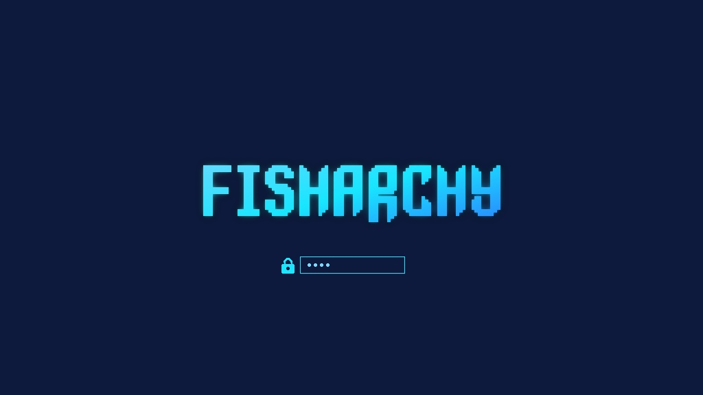

<p align="center"></p>

# FISHARCHY

A custom [Omarchy](https://omarchy.org/) ISO: clean, neon, and built around the
Fish desktop, with [FISHYLAYOUT](https://github.com/wwoooho2-gif/FISHYLAYOUT)
as the shell and bar.

The finished image is published in this repository's **Releases** as
`fisharchy.iso` (split into `fisharchy.iso.part-*` when it exceeds GitHub's
2 GiB per-asset limit). Download every part into one directory and run
`tools/reassemble-iso.sh` there.

```bash
./tools/reassemble-iso.sh ~/Downloads ~/Downloads/fisharchy.iso
```

## Preview

**Boot splash** (neon `#19e6ff` wordmark on `#0d1a3d`, with the disk-unlock prompt):



## What is baked in

| Component | What it does |
|---|---|
| **Neon boot branding** | Plymouth splash and SDDM login screen using the `#0d1a3d` / `#19e6ff` wordmark |
| **Fish theme** | Default desktop theme, animated reef wallpaper, Fish menu buttons |
| **FISHYLAYOUT** | `furina.omarchy-suite` dashboard, quick drawer, plugin manager, glass blur, workspace preview, GPU monitor, better media, taskbar, Alt+Tab |
| **Radio Atlas** | `akshar.radio-atlas` world-radio globe, enabled in the bar |
| **FISHARCHY bar layout** | The current shell layout captured from `shell.json` plus its `shell.toml`: Fish bar on top, Bluetooth, media beside the clock, GPU/audio/network/power on the right, dashboard widgets on the left |
| **No preinstalls** | Omarchy's preinstalled desktop apps, web apps, TUI wrappers, and mise tools are removed before the image is built, and the `preinstalls-removed` opt-out is recorded |
| **Universal image** | One ISO for NVIDIA, AMD and Intel machines: every GPU driver and firmware family stays in, and the installer detects the hardware and picks the driver at install time. A `--lean` build exists for one specific PC only (see the warning under Rebuilding) |
| **Performance and stability layer** | `fisharchy-tuning`: zram swap (zstd), tuned sysctl (one file), systemd-oomd, persistent size-capped journal, bounded core dumps, per-device I/O schedulers, weekly fstrim, BBR, a memory-pressure logger and the `fisharchy-crashlog`, `fisharchy-mode` and `fisharchy-bench` commands |
| **Safe by default** | CPU security mitigations are ON. Max Performance is an opt-in (see below) |

The result is a fresh Omarchy install that boots branded, lands on the Fish
theme, and already has the dashboard layout in place.

## Verify your download

Download `SHA256SUMS` from the same release as the ISO (or every `fisharchy.iso.part-*` file).

```bash
# One-file ISO:
sha256sum -c --ignore-missing SHA256SUMS

# Split ISO: this checks every part, joins them, then checks the joined ISO.
./tools/reassemble-iso.sh ~/Downloads ~/Downloads/fisharchy.iso
```

Both commands must say `OK`. If anything says `FAILED`, download the file again.

## Write the ISO to USB

Writing erases the target device. Identify it first:

```bash
lsblk -o NAME,SIZE,MODEL,TRAN        # your USB stick shows TRAN "usb"; check the size matches
sudo dd if=~/Downloads/fisharchy.iso of=/dev/sdX bs=16M status=progress oflag=sync
```

Replace `/dev/sdX` with the whole device (for example `/dev/sdb`, not `/dev/sdb1`). Re-run `lsblk`
right before `dd`: device names can change when you unplug and replug. Or open the ISO in
[Ventoy](https://www.ventoy.net/) if the stick already uses it.

## Performance modes: Safe and Max Performance

| Mode | Kernel options | Who it is for |
|---|---|---|
| **Safe** (default) | `nowatchdog` only. CPU mitigations (Spectre, Meltdown, L1TF, SRSO) stay ON | Everyone |
| **Max Performance** | `nowatchdog mitigations=off split_lock_detect=off` | People who accept the security risk for a few percent on syscall-heavy work |

Choose at build time:

```bash
./build-fisharchy.sh                    # Safe (default)
./build-fisharchy.sh --max-performance  # or FISHARCHY_PERFORMANCE=max
```

Switch later on an installed system (it states the tradeoff and asks first):

```bash
fisharchy-mode            # show current mode
fisharchy-mode max        # Max Performance
fisharchy-mode safe       # back to Safe
```

The old name `FISHARCHY_PERFORMANCE=0` (mitigations on) still works and means `safe`; `1` means `max`.
`--hardened` is accepted as an alias of `--safe`.

## Performance and stability layer

Installed by the `fisharchy-tuning` package. Every setting has a one-line comment in its file.

| What | File | Measure it |
|---|---|---|
| zram swap, zstd, half of RAM up to 8 GiB, priority 100 (zswap stays off, so they never overlap) | `/usr/lib/systemd/zram-generator.conf.d/fisharchy.conf` | `zramctl`, `swapon --show` |
| sysctl: `vm.max_map_count=1048576`, swappiness, page-cluster 0, cache pressure, dirty limits, BBR + fq | `/usr/lib/sysctl.d/99-fisharchy.conf` | `sysctl vm.swappiness net.ipv4.tcp_congestion_control` |
| systemd-oomd kills the heaviest app scope under memory pressure; the compositor session is marked "avoid" | `/usr/lib/systemd/oomd.conf.d/`, `user.slice.d/` | `oomctl`, `journalctl -u systemd-oomd` |
| Persistent journal capped at 300 MB (so the previous boot's errors survive a crash) | `/usr/lib/systemd/journald.conf.d/10-fisharchy.conf` | `journalctl --disk-usage` |
| Core dumps capped at 1 GB, dumps over 1 GB skipped | `/usr/lib/systemd/coredump.conf.d/` | `coredumpctl list` |
| I/O scheduler per device: NVMe `none`, SSD `mq-deadline`, HDD `bfq`; weekly `fstrim` | `/usr/lib/udev/rules.d/60-fisharchy-ioschedulers.rules` | `cat /sys/block/*/queue/scheduler` |
| Memory pressure logger (1/min: PSI, free RAM, swap, OOM kills, top users when stressed) | `/var/log/fisharchy/memwatch.log` | `tail /var/log/fisharchy/memwatch.log` |

Commands:

- `fisharchy-crashlog` collects the last boot's errors, OOM kills, GPU driver errors, kernel panics,
  core dumps and memory log into one text file in your home directory.
- `fisharchy-bench` records boot time, idle RAM, size on disk and a short CPU and disk test, so you
  can compare Safe vs Max, or before vs after a change.
- `fisharchy-mode` switches Safe / Max Performance.

**What this can and cannot fix.** It helps with crashes caused by running out of memory (the system
kills one runaway app instead of freezing) and with games that need a high `vm.max_map_count`. It
does not fix bad RAM, overheating, a failing disk or GPU driver bugs. If `fisharchy-crashlog` shows
nothing before a crash, test the RAM with [memtest86+](https://memtest.org/) from a separate USB
stick (one full pass at least) and watch temperatures with `sensors`.

Transparent hugepages and multi-gen LRU are left at the kernel defaults on purpose: changing them is
not safe for every machine.

## Packages

Three custom packages come from their own (private) repositories:

- [`omarchy-boot-branding`](https://github.com/wwoooho2-gif/omarchy-boot-branding)
- [`omarchy-fish-theme`](https://github.com/wwoooho2-gif/omarchy-fish-theme)
- [`FISHYLAYOUT`](https://github.com/wwoooho2-gif/FISHYLAYOUT)

Three more recipes live in `packages/`:

- `omarchy-radio-atlas` — packages [AksharP5/omarchy-radio-atlas](https://github.com/AksharP5/omarchy-radio-atlas) for the offline ISO
- `omarchy-no-preinstalls` — first-boot cleanup for the preinstalled apps
- `fisharchy-tuning` — the performance and stability layer above

## Rebuilding

**Rebuilding needs access to the private package repositories** (`omarchy-boot-branding`,
`omarchy-fish-theme`, `FISHYLAYOUT`). Only the repository owner can rebuild the image. The released
ISO is the supported way for everyone else.

```bash
gh auth setup-git          # owner only: the three custom repos are private
./build-fisharchy.sh       # universal image, Safe mode
./build-fisharchy.sh --help
```

The script prints the pinned versions, build date, mode and desktop first, then clones the official
`omacom-io/omarchy-iso` builder at the commit pinned in `iso/versions.env`, resets its cached tree,
applies `iso/fisharchy.patch`, builds six packages with `makepkg`, stages them and runs the Docker ISO
build. It stops early with a clear message if Docker, git, makepkg or bsdtar are missing, if the
private repos cannot be reached, if the pinned commit cannot be fetched, or if the patch no longer
applies. It warns if less than about 20 GB is free. The build downloads several gigabytes.

The same values are written to `/etc/fisharchy-release` on every installed system.
`./build-fisharchy.sh --pin` writes the exact package commits that were built into `iso/versions.env`.

> **Lean build warning.** `--lean` (or `FISHARCHY_KEEP_HARDWARE=0`) builds an ISO **for the exact PC
> it was built on**. It drops other GPU drivers, most firmware, Bluetooth and Wi-Fi families and
> non-English language files, so it **may not boot, or may have no working Wi-Fi, Bluetooth or
> graphics, on any other machine**. Never publish or share a lean ISO.

### Small network-install ISO (`fisharchy.iso`)

```bash
./build-fisharchy.sh --netinstall
```

This builds a small ISO (about 1.4 GiB instead of about 6 GB) and saves it as `fisharchy.iso` next to the
script, with a `fisharchy.iso.sha256`. It needs Docker and git only. After you pick the keyboard layout, the
installer asks you to connect to Wi-Fi (it skips this on Ethernet), then installs Omarchy over the network.

- **It installs stock Omarchy, not the full FISHARCHY image.** After the first boot, run
  `bash tools/fisharchy-postinstall` to build and install the six FISHARCHY packages from their public
  repositories and run the first-boot hooks. Reboot afterwards.
- **Unofficial builder.** It uses a third-party branch of the Omarchy ISO builder (omacom/omarchy-iso pull
  request 256, closed upstream), pinned to an exact commit in `iso/versions.env`. Test it in a virtual
  machine before using it on your laptop.
- **The install needs a working internet connection the whole time.**
- The normal `./build-fisharchy.sh` (full ISO with the FISHARCHY patch) is unchanged.

`iso/fisharchy.patch` does these things to the stock builder:

1. Copies the locally built archives into the offline mirror and keeps them through the prune step.
2. Adds them (and `zram-generator`) to `builder/image.packages`, so they are in the root image that
   installs are written from.
3. Filters Omarchy's preinstall packages out of the shipped install lists. With `--lean` it also drops
   this PC's unused hardware and tool runtimes (T2 Mac kernel, legacy NVIDIA drivers, Surface and
   laptop vendor packages, other GPUs and radios, mise/dotnet/ruby) and prunes firmware to what the
   builder's PC uses. The default universal build leaves all of that in.
4. Trims things no install needs, in every build: theme intro videos, GUI help, documentation, and the
   man database is generated at build time. Non-English locales and translations are removed only in
   the lean build. The build fetches with `ParallelDownloads = 20`.
5. Writes the kernel options for the chosen mode (Safe or Max) into the live ISO, the installed
   `/etc/kernel/cmdline` and the Limine drop-in, and writes `/etc/fisharchy-release`.

First-boot behavior comes from `/etc/skel` hooks installed by the packages: `05-remove-preinstalls`,
`10-fish-theme`, `20-fishylayout-plugin`, `30-radio-atlas-plugin`, `40-fish-layout` and
`50-fisharchy-selfheal`.

## Troubleshooting

**The Docker build fails.**
1. Make sure Docker is running and usable by your user: `docker info`. If not: `sudo systemctl enable --now docker; sudo usermod -aG docker $USER`, then log out and in.
2. Check free space (`df -h`): the build needs about 20 GB.
3. If the message says the patch does not apply, upstream `omarchy-iso` changed. Keep the commit in `iso/versions.env`.
4. If it says a private repo is unreachable, you do not have access: only the owner can rebuild.
   If it says `multiple custom builds found for <package>`, an old copy of that package is in the cached offline mirror. `build-fisharchy.sh` now clears them before each build; on older copies, delete the `omarchy-*`/`fisharchy-*` `.pkg.tar.*` files under `build-work/omarchy-iso/.cache`.
5. After switching between lean/universal or Safe/Max the script clears its cache; to force a clean start, delete `build-work/omarchy-iso/.cache` and `docker volume ls` entries containing "omarchy".

**The ISO does not boot from USB.**
1. Re-verify the download (`sha256sum -c`), then re-write the stick; check `lsblk` before `dd`.
2. Try another USB port or stick, and write with `dd` or Ventoy rather than a file copy.
3. In the firmware setup: boot in UEFI mode, and turn Secure Boot off (or enroll the keys) if the stick is not listed.
4. A `--lean` ISO will not boot on machines other than its build PC; use the universal ISO.

**The installer does not detect the GPU.**
1. Check what the live system sees: `lspci -nnk | grep -A3 -Ei 'vga|3d|display'`.
2. Hybrid laptops show two GPUs; the install should pick the NVIDIA driver and keep the integrated GPU for the desktop. Report the `lspci` output if the wrong driver is chosen.
3. A black screen or the red failure screen on a non-NVIDIA laptop often means the ISO was a lean build. Use the universal ISO and save the installer log.

## Screenshot checklist

Compare a fresh install with the screenshots under `docs/preview/`:

- [ ] **Boot splash:** matches `docs/preview/boot.png`: navy `#0d1a3d` background, pixel-style cyan-to-blue FISHARCHY wordmark, lock icon and password box below it, no text boot messages.
- [ ] **Login (SDDM):** neon login screen with the same palette and wordmark.
- [ ] **Desktop:** Fish theme with the animated reef wallpaper behind the windows.
- [ ] **Bar:** Fish menu button at the left, media beside the clock, GPU/audio/network/power icons on the right.
- [ ] **Dashboard and dock:** widgets on the left, dock at the bottom.
- [ ] **Radio Atlas:** the globe opens from the bar.
- [ ] **Terminal:** `cat /etc/fisharchy-release` shows the version, mode (`performance=safe` by default) and desktop.

## Licensing

- The build scripts and recipes in this repository are MIT (see `LICENSE`).
- Omarchy is MIT and bundled third-party plugins (such as Radio Atlas) keep their own licenses.
- The three custom packages (`omarchy-boot-branding`, `omarchy-fish-theme`, `FISHYLAYOUT`) are included
  under the license stated in their own repositories. **TODO (owner): fill in here if those
  repositories have no license file:** `<LICENSE OF THE THREE CUSTOM PACKAGES>`.

See `ROADMAP.md` for what is planned (installer menus, backup and restore, and more).
