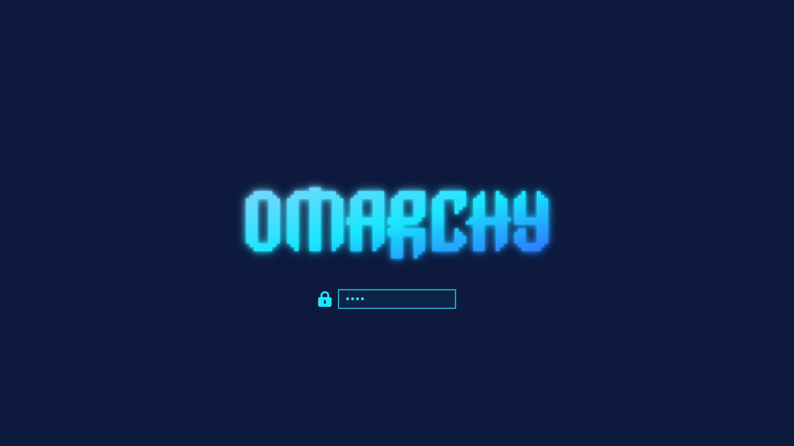
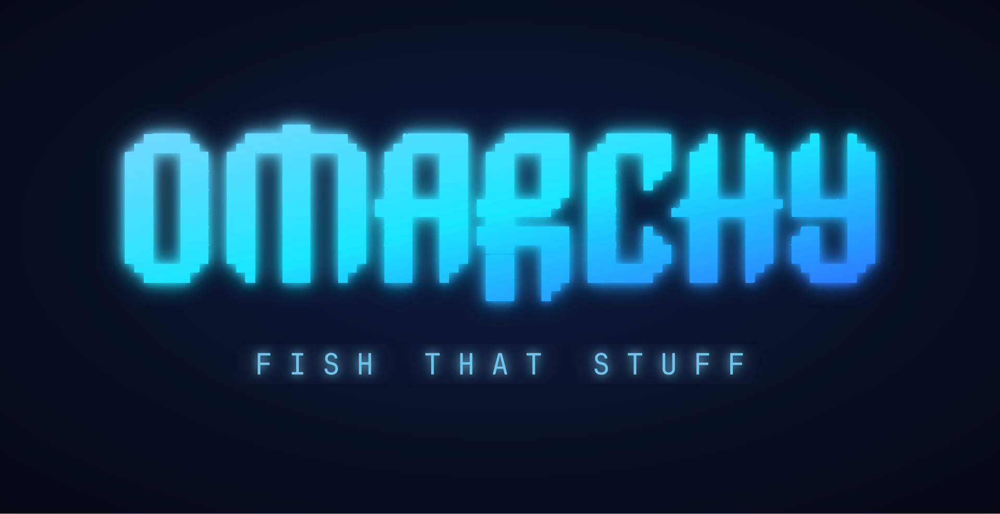
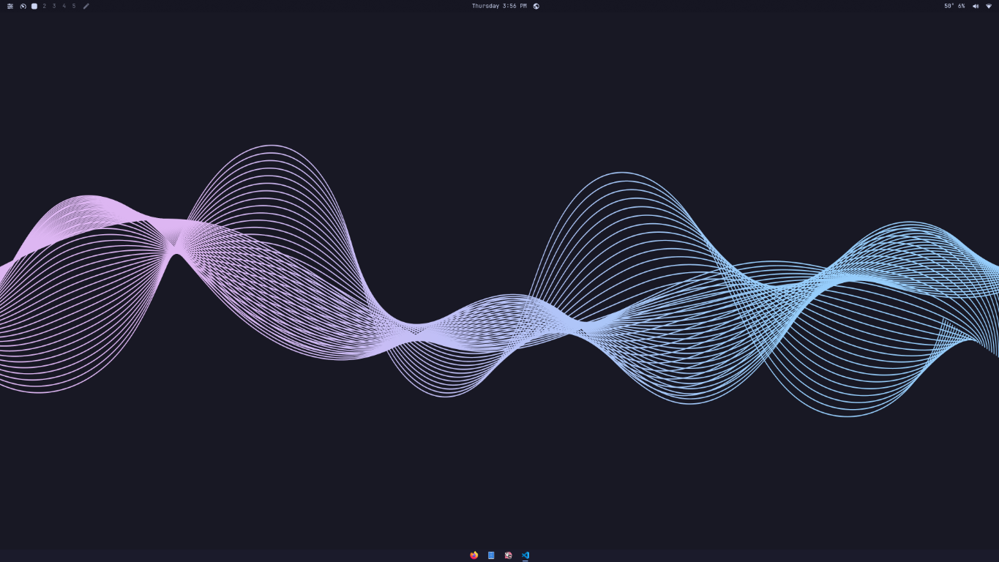
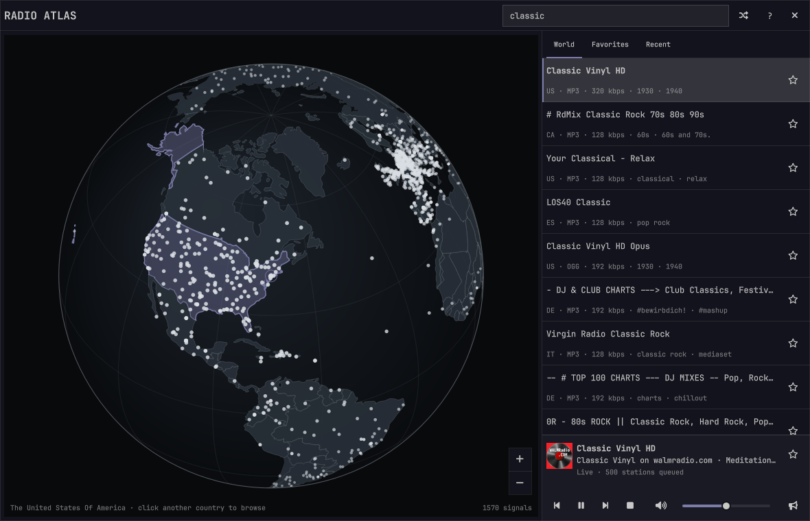

# FISHARCHY

A custom [Omarchy](https://omarchy.org/) ISO: clean, neon, and built around the
Fish desktop, with [FISHYLAYOUT](https://github.com/wwoooho2-gif/FISHYLAYOUT)
as the shell and bar.

The finished image is published in this repository's **Releases** as
`FISHARCHY.iso` (split into `FISHARCHY.iso.part-*` when it exceeds GitHub's
2 GiB per-asset limit). Download every part into one directory and run
`tools/reassemble-iso.sh` there.

```bash
./tools/reassemble-iso.sh ~/Downloads ~/Downloads/FISHARCHY.iso
```

## Preview

| Boot splash | SDDM login |
|---|---|
|  |  |

| Fish theme desktop | FISHARCHY bar layout |
|---|---|
|  |  |



## What is baked in

| Component | What it does |
|---|---|
| **Neon boot branding** | Plymouth splash and SDDM login screen using the `#0d1a3d` / `#19e6ff` wordmark |
| **Fish theme** | Default desktop theme, animated reef wallpaper, Fish menu buttons |
| **FISHYLAYOUT** | `furina.omarchy-suite` dashboard, quick drawer, plugin manager, glass blur, workspace preview, GPU monitor, better media, taskbar, Alt+Tab |
| **Radio Atlas** | `akshar.radio-atlas` world-radio globe, enabled in the bar |
| **FISHARCHY bar layout** | The current shell layout captured from `shell.json` plus its `shell.toml`: Fish bar on top, Bluetooth, media beside the clock, GPU/audio/network/power on the right, dashboard widgets on the left |
| **No preinstalls** | Omarchy's preinstalled desktop apps, web apps, TUI wrappers, and mise tools are removed before the image is built, and the `preinstalls-removed` opt-out is recorded |
| **Lean image** | Built for this desktop: the T2 Mac kernel, legacy NVIDIA drivers, Surface firmware, other machines' radios and GPUs, unused dev runtimes, theme intro videos, GUI help and every firmware family this machine does not use are left out of the download (about 1.5 GB smaller) |

The result is a fresh Omarchy install that boots branded, lands on the Fish
theme, and already has the dashboard layout in place.

## Packages

Three custom packages come from their own repositories:

- [`omarchy-boot-branding`](https://github.com/wwoooho2-gif/omarchy-boot-branding)
- [`omarchy-fish-theme`](https://github.com/wwoooho2-gif/omarchy-fish-theme)
- [`FISHYLAYOUT`](https://github.com/wwoooho2-gif/FISHYLAYOUT)

Two more recipes live in `packages/`:

- `omarchy-radio-atlas` — packages [AksharP5/omarchy-radio-atlas](https://github.com/AksharP5/omarchy-radio-atlas) for the offline ISO
- `omarchy-no-preinstalls` — first-boot cleanup for the preinstalled apps

## Write the ISO to USB

```bash
sudo dd if=~/Downloads/FISHARCHY.iso of=/dev/sdX bs=16M status=progress oflag=sync
```

Replace `/dev/sdX` with the USB device (not a partition). Or just open the ISO
in [Ventoy](https://www.ventoy.net/) if the stick already uses it.

## Rebuild it yourself

`build-fisharchy.sh` reproduces the image from scratch:

```bash
gh auth setup-git          # the three custom repos are private
./build-fisharchy.sh
```

It clones the official `omacom-io/omarchy-iso` builder at the pinned commit,
applies `iso/fisharchy.patch`, builds the five packages with `makepkg`, stages
them in the builder's `custom-packages/` volume, and runs the ISO build. Docker
is required; the build downloads several gigabytes and takes a while.

`iso/fisharchy.patch` does three things to the stock builder:

1. Copies the locally built archives into the offline mirror and keeps them
   through the prune/index step.
2. Adds them to `builder/image.packages`, so they are installed in the root
   image that fresh installs are written from.
3. Filters Omarchy's preinstall packages out of the shipped install lists, and
   drops this desktop's unused hardware and tool runtimes (T2 Mac kernel,
   legacy NVIDIA drivers, Surface and laptop vendor packages, AMD/Intel/other
   GPUs and radios, mise/dotnet/ruby). In the root image it also removes the
   theme intro videos, GUI help and all firmware except the Intel Wi-Fi and
   Bluetooth, Realtek Ethernet, NVIDIA GPU and CPU microcode this machine uses.
   Build with `FISHARCHY_KEEP_HARDWARE=1 ./build-fisharchy.sh` for the full
   compatibility image.

First-boot behavior comes from `/etc/skel` hooks installed by the packages:
`05-remove-preinstalls`, `10-fish-theme`, `20-fishylayout-plugin`,
`30-radio-atlas-plugin`, and `40-fish-layout`.

## License

MIT. Omarchy itself is MIT; bundled third-party plugins keep their own licenses
under each plugin's `features/` or source directory.
